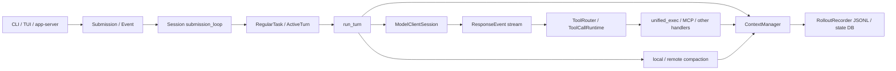
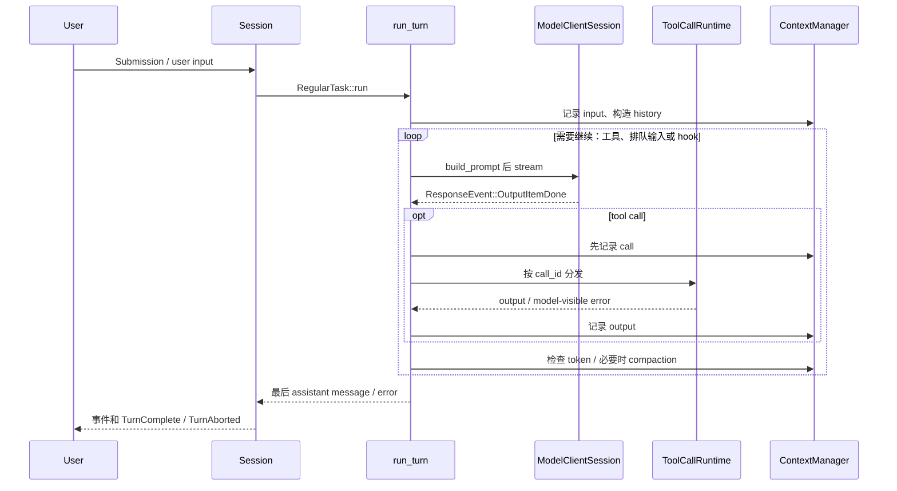

# Codex 源码深度学习笔记

> 分析对象：本地 Git 提交 `970111f6c`，以 `codex-rs/core`、`codex-rs/rollout`、`codex-rs/protocol` 的当前源码为准。`codex-rs/Cargo.toml:170` 的 workspace 版本为 `0.0.0`，不能据此推断发行版号。本文只验证以下列出的链路；其他前端、云端和全部平台后端没有逐一审计。下文的“事实”指源码可直接观察的行为；“评价/建议”是工程判断。

## 1. 项目整体架构

Rust workspace 的 `codex-core` 实现会话、模型请求、工具和执行控制；`codex-rollout` 写入及读取持久化事件；`codex-protocol` 定义操作、事件和错误。客户端入口很多，本文从 core 的统一边界入手：`Session::submit_with_id`（`codex-rs/core/src/session/mod.rs:1104`）将 `Submission` 送进 `submission_loop`（`codex-rs/core/src/session/handlers.rs:443`）；普通任务由 `Session::spawn_task/start_task`（`codex-rs/core/src/tasks/mod.rs:273,286`）交给 `RegularTask::run`（`codex-rs/core/src/tasks/regular.rs:40`），再进入 `run_turn`（`codex-rs/core/src/session/turn.rs:174`）。`Session`、`TurnContext` 分别承载会话共享服务及一轮配置（`codex-rs/core/src/session/session.rs:60`、`codex-rs/core/src/session/turn_context.rs:323`）；`StepContext` 由当前 turn 捕获的环境、模型及工具计划组成，工具异步执行时保留该快照（`codex-rs/core/src/tools/parallel.rs:46-51`）。`Task` 是 turn 中可取消的工作，不等于持久化 thread。

**完整数据流。** `ContextManager::record_items` 保存 API 可见项，并在 live history 中裁剪工具输出（`codex-rs/core/src/context_manager/history.rs:507,555`）；`for_prompt` 做成对 call/output、模态清理（同文件 `603,966`）。`run_sampling_request` 取得 history，附加已执行工具元数据，再调用 `build_prompt` 放入工具规格、base instructions 和 schema（`codex-rs/core/src/session/turn.rs:1773-1805,1689-1716`）。`try_run_sampling_request` 消费流事件，`handle_output_item_done` 在记录 tool call 后安排执行，结果由 `drain_in_flight` 按序写回 history（`codex-rs/core/src/session/turn.rs:2807,3022,2604`；`codex-rs/core/src/stream_events_utils.rs:317-370`）。持续循环的条件是模型工具调用、排队输入或 Stop hook 要求继续；无后续工作时退出（`codex-rs/core/src/session/turn.rs:620-756`）。

## 2. 最值得学习的核心工程设计

| 排名 | 机制 | 解决的问题 | 核心文件 | 学习价值 | 推荐优先级 |
|---:|---|---|---|---|---|
| 1 | Turn/Step 快照与循环 | 长任务中状态漂移 | `codex-rs/core/src/session/turn.rs` | 控制流骨架 | 最高 |
| 2 | Context 预算与估算 | 请求溢出 | `codex-rs/core/src/session/context_window.rs` | 明确软阈值/硬上限 | 最高 |
| 3 | Local compaction 与历史替换 | 长历史不可继续 | `codex-rs/core/src/compact.rs` | 保留目标与失败恢复 | 最高 |
| 4 | Remote/后台 compaction | 压缩延迟 | `codex-rs/core/src/compact_remote_v2.rs` | 候选版本校验 | 高 |
| 5 | Tool 输出双重限流 | 巨量日志淹没上下文 | `codex-rs/core/src/tools/context.rs` | 内存和 token 双边界 | 最高 |
| 6 | Tool dispatch 与并发门 | 错误/竞态 | `codex-rs/core/src/tools/parallel.rs` | 并行读、独占写 | 最高 |
| 7 | 流式重试与错误分类 | 网络不稳定 | `codex-rs/core/src/responses_retry.rs` | 区分重试和终止 | 高 |
| 8 | 长命令会话 | 工具执行超时 | `codex-rs/core/src/unified_exec/process_manager.rs` | yield/poll/取消 | 高 |
| 9 | Rollout 与重建 | 内存丢失 | `codex-rs/rollout/src/recorder.rs` | 事件日志和恢复 | 高 |
| 10 | Cancellation/任务生命周期 | 中断遗留半成品 | `codex-rs/core/src/tasks/mod.rs` | 层级取消 | 高 |
| 11 | Sandbox 与审批 | 工具越权 | `codex-rs/core/src/tools/sandboxing.rs` | 授权嵌入执行链 | 高 |

### 1. Turn/Step 快照与 Agent Loop

**解决的问题**：模型可能连续请求工具、用户中途补充输入、配置或工具清单变化。单次模型响应不能代表一个完整 turn。

**实现思路与关键源码**：`submission_loop` 分派操作，`spawn_task` 建立 active turn 与 cancellation token，`RegularTask::run` 重复 `run_turn` 直到队列清空（`codex-rs/core/src/session/handlers.rs:443`；`codex-rs/core/src/tasks/mod.rs:273-395`；`codex-rs/core/src/tasks/regular.rs:99-130`）。`run_turn` 捕获 `StepContext`、记录输入、循环采样并判断 `needs_follow_up`（`codex-rs/core/src/session/turn.rs:174-330,473-620`）。

**核心调用链**：`Submission → spawn_task → RegularTask::run → run_turn → run_sampling_request → try_run_sampling_request → 回到 run_turn`。`ToolCallRuntime` 保存发布该工具时的 step，避免延迟执行时错用下一 step 的工具计划（`codex-rs/core/src/tools/parallel.rs:46-65`）。

**边界、测试与评价**：无 follow-up 时 Stop hook 仍可插入 continuation；普通错误发事件并结束当前 turn，保留会话可继续（`codex-rs/core/src/session/turn.rs:746-913`）。`codex-rs/core/src/session/tests.rs:8571,10291` 覆盖 task span 与非普通任务设置隔离。设计代价是 Session/Turn/Step 三层状态需要明确所有权；自己实现时先固定不可变 step 快照，再给每个 turn 独立取消令牌和可观测事件。

### 2. Context Window 与 Token Budget

**解决的问题**：不能只按字符数截断历史，也不能假设模型 context window 等于安全可用预算。

**实现思路与关键源码**：`context_window_token_status_with_config` 取当前使用量；可按 total 或 prefix 之后的 body 计数，分别比较 auto-compact limit 和模型有效硬上限，并计算 post-turn 阈值（`codex-rs/core/src/session/context_window.rs:53-120`）。`estimate_item_token_count` 以模型可见字节近似 token，还给 image/audio 单独估值，属于**估算**而非 tokenizer 精确计费（`codex-rs/core/src/context_manager/history.rs:1074-1115`）。模型 context 配置在 `ModelInfo`：`resolved_context_window` 选 `context_window` 或 `max_context_window`，`auto_compact_token_limit` 取配置值与窗口 90% 的较小者（`codex-rs/protocol/src/openai_models.rs:413,523-545`）；`TurnContext::model_context_window` 读取它（`codex-rs/core/src/session/turn_context.rs:768`）。具体模型目录未全面审计。

**调用链与边界**：`run_turn → context_window_token_status → pre/mid/post compaction`（`codex-rs/core/src/session/turn.rs:1395-1427,620-704,793-849`）。`run_turn` 顶部 TODO 明确**尚未实现**对即将注入的新输入及 context diff 的预估，所以低于阈值的大输入仍可能把请求撑爆（`codex-rs/core/src/session/turn.rs:194-198`）。相关测试用不同 effective window 百分比检查 prompt contributor 接收的窗口信息（`codex-rs/core/src/session/tests.rs:10841,10869`），后台压缩测试实际调用 token status（`codex-rs/core/src/session/async_compaction_tests.rs:71`）；本文未发现覆盖“大输入预估”的测试。优点是软阈值和硬上限分离；代价是估算误差与补偿请求。自行实现应将模型反馈 usage 校正估算，并预留输入、输出和工具结果预算。

### 3. Local Compaction：摘要加受限原始输入

**解决的问题**：直接丢弃最老历史会遗失用户目标、变更缘由及最近证据。

**实现思路与关键源码**：本地分支由 `run_auto_compact` 选择（`codex-rs/core/src/session/turn.rs:1530-1614`），`run_compact_task_inner_impl` 用当前 history 请求模型摘要；`build_compacted_history_with_limit` 从最近用户消息反向选择、预算内保留文本，并追加 summary（`codex-rs/core/src/compact.rs:263-438,697-819`）。成功时 `replace_compacted_history`、推进 window 并重新计 token（同文件 `402-438`）。这是**模型摘要**，并非纯规则压缩。

**边界与失败**：压缩请求遇 context overflow，会依次移除压缩输入中的最老项再重试；最终只有一项仍失败则终止，避免无限循环（`codex-rs/core/src/compact.rs:350-371`）。前置压缩失败先记录新用户输入，避免丢 prompt（`codex-rs/core/src/session/turn.rs:199-241`）；post-turn 压缩失败保留刚完成的答案（同文件 `793-844`）。`codex-rs/core/src/compact_tests.rs:30,502,605,697` 验证重试时指令/工具元数据、用户消息预算和摘要顺序。评价：摘要有 token 与延迟成本，且会丢细节；自己实现时同时保存最近原文、摘要来源元数据及压缩 window 编号，失败时原历史不可覆盖。

### 4. Remote V2 与后台 Compaction 候选

**解决的问题**：同步压缩增加长任务等待；后台结果又可能基于过期历史。

**实现思路与关键源码**：provider 声明 `RemoteCompactionSupport::V2` 时走 remote；否则走 local，`TokenBudget` 特性则走 reset 路线，三者不能混写成一种算法（`codex-rs/core/src/session/turn.rs:1561-1616`）。`async_compaction::maybe_start` 在阈值合适且尚未到强制压缩时记录 `history_version`、model、hash、auth owner 并启动后台请求；`take_ready` 仅采纳 generation 等于当前 history version 的候选（`codex-rs/core/src/session/async_compaction.rs:52-163`）。Remote V2 从原输入按规则保留选定项，给消息设置 64K token retention budget，然后加入 compaction 输出（`codex-rs/core/src/compact_remote_v2.rs:87,480-505`）。

**边界、测试与评价**：候选不可用时可等待现有任务或回退前台请求（`codex-rs/core/src/compact_remote_v2.rs:168-238`）；取消的新 turn 不启动后台压缩，已启动任务属于 session（`codex-rs/core/src/session/async_compaction_tests.rs:15`）。`codex-rs/core/src/compact_remote_v2.rs:845,958,1036` 覆盖保留形状、元数据和新消息优先。优点是隐藏压缩延迟；代价是额外并发请求，且过期候选被丢弃。迁移时以 history generation 做 compare-and-install，切勿直接覆盖前台变化。

### 5. 工具输出的内存边界与模型边界

**解决的问题**：shell 或 MCP 输出可达几十万字符，一次性放进 history 会撑爆窗口。

**实现思路与关键源码**：`UnifiedExecProcess` 用 1 MiB 的 `HeadTailBuffer` 保存 pending/transcript（`codex-rs/core/src/unified_exec/mod.rs:74-77`；`codex-rs/core/src/unified_exec/process.rs:45-57`）；`ExecCommandToolOutput::response_text` 按 token/byte policy 裁剪，预留 header 与 omission marker 空间（`codex-rs/core/src/tools/context.rs:527-621`）。MCP 的 `response_payload` 对结构化内容也裁剪，Code Mode 返回路径与 history 路径不同，不能认为所有消费者拿到同一文本（同文件 `239-260,483-524`）。`ContextManager::record_item_with_metadata` 对进入 live history 的 function/custom 输出再次应用策略；注释明确 rollout 保留原 payload（`codex-rs/core/src/context_manager/history.rs:517-578`）。

**边界、测试与评价**：截断标记说明原始 token 和遗漏字节，不会把“结果完整”伪装给模型。`codex-rs/core/src/tools/context_tests.rs:133,411,459,505`、`codex-rs/core/src/unified_exec/process_manager_tests.rs:345,399` 覆盖结构化截断、metadata 预算、重复 drain。代价是错误位置可能落在被省略中段；自行实现应留首尾、保留遗漏计数，并允许用户按需再取原日志。

### 6. Tool Registry、并发门与错误回模型

**解决的问题**：模型可能输出未知工具、无效参数或同轮多个 tool call；副作用工具不可无条件并行。

**实现思路与关键源码**：`ToolRegistry` 按 `ToolName` 注册且执行 policy/重复名检查（`codex-rs/core/src/tools/registry.rs:406-535`）；`ToolRouter::build_tool_call` 将模型 `FunctionCall`/`CustomToolCall` 等转换为带 `call_id` 的内部结构，坏 `tool_search` JSON 变 `RespondToModel`（`codex-rs/core/src/tools/router.rs:257-310`）。`handle_output_item_done` **先记录 call**，再安排执行；`ToolCallRuntime` 的 `RwLock` 让支持 parallel 的工具取读锁，其余取写锁（`codex-rs/core/src/stream_events_utils.rs:317-371`；`codex-rs/core/src/tools/parallel.rs:129-255`）。`FuturesOrdered` 收集结果，`drain_in_flight` 按输出顺序写 history（`codex-rs/core/src/session/turn.rs:2778,2604-2630`）。

**失败与一致性**：执行期的普通 `FunctionCallError` 被转成对应 `call_id` 的失败 output，模型可继续；构造 call 阶段的 `RespondToModel` 也会写入解释性 output，但该路径使用空 `call_id`，不能声称保持原 ID；Fatal 才向上冒泡（`codex-rs/core/src/tools/parallel.rs:74-119`）。取消未派发 call 也造 aborted output，维持 call/output 配对（`codex-rs/core/src/stream_events_utils.rs:352-370`）。`codex-rs/core/src/context_manager/normalize.rs:21,171` 在请求前补缺失 output、删孤儿 output；`codex-rs/core/src/tools/parallel_observation_tests.rs:20` 验证取消时的观测。**局限**：这里不是跨工具事务，也没有通用副作用幂等保证；一个工具失败不会自动回滚已完成的并发工具。自行实现应把每个 call ID 的状态、执行前/后事件和重试策略分开，非幂等工具默认不自动重试。

### 7. 模型流错误分类、退避与传输降级

**解决的问题**：429、网络断开、流中途结束各有不同恢复语义。

**实现思路与关键源码**：`CodexErr::retry_delay` 对取消、上下文溢出、usage limit 等直接返回 `None`；对 rate limit、stream、连接、timeout 等返回 server delay 或 backoff（`codex-rs/protocol/src/error.rs:418-470`）。`run_sampling_request` 对 context overflow 标记 token full、对 usage limit 更新状态，其他错误交给 `handle_response_stream_error`（`codex-rs/core/src/session/turn.rs:1806-1860`）。后者按 provider `stream_max_retries` 计数、尊重 `Retry-After`，达到次数上限可从 WebSocket 降到 HTTPS；特性启用时，部分连接失败可使用上限递增的无限连接重试（`codex-rs/core/src/responses_retry.rs:58-174`）。

**边界、测试与评价**：没有 `response.completed` 的 EOF 生成 Stream 错误，未完整响应 usage 仍记录（`codex-rs/core/src/session/turn.rs:2864-2898`）。`codex-rs/core/src/responses_retry_tests.rs:17,59` 覆盖重试事件和 deadline。重试的是**模型请求**，不是重跑已执行工具；但流断开前部分输出的协调仍有代码 TODO（`codex-rs/core/src/session/turn.rs:2840-2854`）。实现自己的系统时必须把“可重放请求”和“外部副作用已发生”分别记账。

### 8. 长命令的 yield、poll 与进程治理

**解决的问题**：shell 命令可能长时间运行、产出大量输出或被取消。

**实现思路与关键源码**：`exec_command_inner` 启动进程、发布 Begin 事件、保存活动 process，并只等待钳制后的 yield 时间；若未结束，输出 `process_id`，后续 `write_stdin` 可轮询/写入（`codex-rs/core/src/unified_exec/process_manager.rs:520-665,896-930`）。每个进程有 `interaction_lock` 串行化 poll/write，process state 与输出缓冲分离；进程 Drop 会 terminate（`codex-rs/core/src/unified_exec/process.rs:99-115,700`）。模块设置 yield 上下界、默认后台 timeout、最多 64 个进程（`codex-rs/core/src/unified_exec/mod.rs:69-78`）。

**边界与评价**：超时的进程 `exit_code()` 报 124（`codex-rs/core/src/unified_exec/process.rs:214-224`）；写入前审批且审批后重新检查 process identity，避免 ID 被复用后误写（`codex-rs/core/src/unified_exec/process_manager.rs:912-1005`）。`codex-rs/core/src/unified_exec/process_manager_tests.rs:45,345,543,609` 覆盖 ID、缓冲和淘汰。自主实现时把“等待本次工具返回”和“进程生命周期”解耦，保留有界日志及显式进程 ID。

### 9. Rollout 事件日志与历史重建

**解决的问题**：内存中的 history 失去后需继续会话，同时不能依赖单次请求快照。

**实现思路与关键源码**：`RolloutRecorder` 用异步 writer 记录 canonical items；`persist`、`flush`、`shutdown` 经 channel 顺序处理，`flush` 首次写失败会尝试重开（`codex-rs/rollout/src/recorder.rs:86,1079-1138,1224`）。`ThreadManager::resume_thread_with_history` 创建恢复线程；`ContextManager::reconstruct_rollout` 选 compaction checkpoint 后回放后缀（`codex-rs/core/src/thread_manager.rs:1345-1373`；`codex-rs/core/src/session/rollout_reconstruction.rs:208-237`）。

**边界、测试与评价**：`codex-rs/rollout/src/recorder_tests.rs:695,1150,1223` 覆盖延迟落盘、危险尾部修复、残缺前缀；`codex-rs/core/src/session/rollout_reconstruction_tests.rs:35,1442,1469` 覆盖恢复后的输入顺序及初始/压缩窗口选择。持久化的是会话事件和可重建 context，**未验证**恢复被强杀的外部进程或未完成工具副作用。自行实现时 append-only 日志加显式 checkpoint，定义 flush 完成才算 durable 的边界。

### 10. Cancellation 与任务生命周期

**解决的问题**：用户中断、替换 turn 或 session shutdown 时，模型流和工具任务可能仍在运行。

**实现思路与关键源码**：`Session::spawn_task` 先 abort 前一 task，`start_task` 给新 task 创建 token（`codex-rs/core/src/tasks/mod.rs:273-338`）。`try_run_sampling_request` 对流读取和取消作 `tokio::select` 式竞争，取消后返回 `TurnAborted`，再 drain 已在执行的工具（`codex-rs/core/src/session/turn.rs:2820-2868,3431-3452`）。`ToolCallRuntime` 对可取消 handler abort task，对声明 `finishes_on_cancellation` 的 handler 等待其结尾，均通知终止状态（`codex-rs/core/src/tools/parallel.rs:255-343`）。

**边界、测试与评价**：`codex-rs/core/src/session/tests.rs:8877` 验证 submission channel 关闭时先中断 active turn；`codex-rs/core/src/session/async_compaction_tests.rs:15` 验证 turn 取消不错误清除 session-owned 压缩。取消不等于外部副作用自动撤销；应把工具完成/中止状态记录到可观察事件，必要时设计补偿操作。

### 11. Sandbox、审批和最小授权

**解决的问题**：模型给出的命令或 MCP 调用可能触碰受限文件、网络或外部服务。

**实现思路与关键源码**：`default_exec_approval_requirement` 将审批策略和 filesystem sandbox 结合，`sandbox_override_for_first_attempt` 明确 denied-read 不能通过简单 bypass 消失（`codex-rs/core/src/tools/sandboxing.rs:196-290`）。`SandboxAttempt::env_for` 将权限、cwd、network 转换为实际执行请求（同文件 `466-519`）。`Session::request_approval` 先运行 permission hooks，再交 reviewer；session approval cache 只缓存 `ApprovedForSession`（`codex-rs/core/src/tools/approvals.rs:465-522`；`codex-rs/core/src/tools/sandboxing.rs:72-118`）。

**边界、测试与评价**：`write_stdin` 会拒绝过大、无法完整审阅的输入，并在审批后重新核对 process identity（`codex-rs/core/src/unified_exec/process_manager.rs:927-1005`）。`codex-rs/core/src/tools/approvals_tests.rs:9,42` 覆盖不允许的网络 amendment 和审批取消；`codex-rs/core/src/unified_exec/stdin_approval_tests.rs:39,70` 覆盖降权及 denied reads 的审阅要求。安全机制贯穿工具执行链，而不是仅在 prompt 提醒模型；代价是交互延迟和权限状态复杂。自己实现应把权限决策放在执行器之前，并把“已批准某命令”与“可绕过全部文件限制”分开。

## 3. Harness Engineering 专题

| 主题 | 状态 | 已核实的实际路径与限制 |
|---|---|---|
| Context Window / Token Budget | 已验证实现 | `context_window_token_status_with_config` 计算 body/total 软阈值和硬 cap；估算见 `estimate_item_token_count`（`codex-rs/core/src/session/context_window.rs:53`、`codex-rs/core/src/context_manager/history.rs:1074`）。新输入预估仍是 TODO（`codex-rs/core/src/session/turn.rs:194`）。 |
| Context Compaction | 已验证实现 | local 模型摘要、remote V2、TokenBudget reset 三路径（`codex-rs/core/src/session/turn.rs:1530`）；压缩失败保留 input/已完成答案。 |
| Tool Output Truncation | 已验证实现 | shell bounded buffer + model output policy + live history 再裁剪（`codex-rs/core/src/unified_exec/process.rs:45`、`codex-rs/core/src/tools/context.rs:527`、`codex-rs/core/src/context_manager/history.rs:555`）。 |
| Tool Call Dispatch | 已验证实现 | Registry/Router/`ToolCallRuntime`，按 call_id 回填；parallel RW gate（`codex-rs/core/src/tools/router.rs:257`、`codex-rs/core/src/tools/parallel.rs:129`）。 |
| Retry / Timeout / Backoff | 已验证实现 | 模型流错误按类别重试、Retry-After 和 WebSocket fallback（`codex-rs/core/src/responses_retry.rs:58`）；shell yield 与进程 timeout 独立（`codex-rs/core/src/unified_exec/process_manager.rs:520`）。 |
| Error Recovery | 部分实现 | 普通工具错误给模型，Fatal 终止；stream EOF 重试，context overflow 触发压缩。**未发现实现**通用外部副作用幂等或跨工具回滚。 |
| Streaming | 已验证实现 | `ResponseEvent::OutputItemDone` 调度工具，delta 实时发事件，未完成 usage 记录（`codex-rs/core/src/session/turn.rs:2807-3023`）。 |
| Session Persistence | 已验证实现 | rollout writer、flush 与 reconstruction（`codex-rs/rollout/src/recorder.rs:1079-1138`、`codex-rs/core/src/session/rollout_reconstruction.rs:208`）。外部进程恢复**尚未验证**。 |
| Cancellation | 已验证实现 | turn token、流取消、tool abort/等待 finish（`codex-rs/core/src/tasks/mod.rs:320`、`codex-rs/core/src/tools/parallel.rs:255`）。外部副作用撤销**未发现实现**。 |
| Security / Approval | 已验证实现 | sandbox transform、hooks/reviewer、stdin 再校验（`codex-rs/core/src/tools/sandboxing.rs:466`、`codex-rs/core/src/tools/approvals.rs:465`）。具体 OS 沙箱内核规则未逐平台审计。 |

**Prompt cache / 增量复用边界。** `build_prompt` 的 `incremental_tools` 分支省略重复工具声明和 base instructions（`codex-rs/core/src/session/turn.rs:1689-1716`），`ModelClientSession` 维持 turn 级传输状态（`codex-rs/core/src/client.rs:297,2392`）。这说明客户端实现了增量请求与缓存友好的历史组织；服务端实际缓存命中率及账单效果**尚未验证**，不能当作已有强保证。

**故障分类核对。** 以下区分“执行失败”“工具返回了失败信息”和“请求失败”：

| 故障 | 捕获与可见结果 | 自动重试 / 限制 |
|---|---|---|
| Shell 超时或异常退出 | `UnifiedExecProcess::exit_code` 将 timeout 表示为 124；`ExecCommandToolOutput` 将 exit code 放入响应 header（`codex-rs/core/src/unified_exec/process.rs:214-224`；`codex-rs/core/src/tools/context.rs:568-590`） | 未发现通用自动重跑命令；调用方/模型根据输出决定下一步。 |
| Shell 非零 exit code | 工具结果包含 `Process exited with code …`，`ExecCommandToolOutput::success_for_logging` 仍返回 true（`codex-rs/core/src/tools/context.rs:439-455,568-590`） | 不能把它等同于 ToolRegistry handler 错误，也没有通用自动重试。 |
| 工具参数 JSON 无效 | `build_tool_call` 对 `tool_search` JSON 解析失败生成 `RespondToModel`；`handle_output_item_done` 记录解释性输出（`codex-rs/core/src/tools/router.rs:277-289`；`codex-rs/core/src/stream_events_utils.rs:413-437`） | 由模型再生成调用；此特殊输出使用空 call_id，关联语义弱于正常执行期输出。 |
| 执行期 handler 错误 / 并发某项失败 | `ToolCallRuntime::handle_tool_call` 把非 Fatal 错误转为该调用的失败 output；Fatal 向上抛（`codex-rs/core/src/tools/parallel.rs:70-119`） | 未发现通用工具重试；其他并发工具不自动回滚。 |
| 用户取消正在运行的工具 | `ToolCallRuntime` abort 或等待声明需完成的 handler，并发布 aborted 状态（`codex-rs/core/src/tools/parallel.rs:255-343`） | 取消不代表副作用撤销。 |
| 模型网络断开 / 429 / 流 EOF | `retry_delay` 分类；EOF 在流循环生成 `Stream`，外层 `handle_response_stream_error` 决定退避/降级（`codex-rs/protocol/src/error.rs:418-470`；`codex-rs/core/src/session/turn.rs:2876-2900,1838-1859`） | 受 provider 次数上限；连接特例可无限重试；明确 UsageLimitReached 不重试。 |
| MCP 服务超时或非法返回格式 | 本文未追踪到从 MCP transport 到具体 handler 的完整错误链，故**尚未验证**其独立重试与超时策略 | 不应从模型流重试策略推断 MCP 工具也会重试。 |

## 4. 典型故障场景分析

1. **接近上限又输入大型任务**：已有 usage 触发 `run_pre_sampling_compact`（`codex-rs/core/src/session/turn.rs:1395`）→ history/window 推进（`codex-rs/core/src/compact.rs:402`）→ 再记录输入并采样；若压缩失败，先保留新输入再报错（`codex-rs/core/src/session/turn.rs:199-241`）。局限：输入本身的预估压缩尚未实现；真实请求仍可能 overflow，普通 turn 错误结束，特定 Guardian 分支可再压一次（`codex-rs/core/src/session/turn.rs:850-879`）。
2. **工具返回几十万字符**：`UnifiedExecProcess` 1 MiB head/tail 缓冲（`codex-rs/core/src/unified_exec/process.rs:45`）→ 工具结果按模型 policy 截断并写 marker（`codex-rs/core/src/tools/context.rs:527-621`）→ live history 再限额（`codex-rs/core/src/context_manager/history.rs:555-578`）→ 模型看到缩略结果。MCP 的结构化结果走单独截断（`codex-rs/core/src/tools/context.rs:239-260`）。
3. **Shell 长时间不返回**：`exec_command_inner` 启动并保存进程，yield 时间到即回 `process_id`（`codex-rs/core/src/unified_exec/process_manager.rs:520-665`）→ `write_stdin` 用同 ID 轮询/写入（同文件 `896-930`）→ timeout 报 124；进程表受 64 个上限与清理策略约束（`codex-rs/core/src/unified_exec/mod.rs:77`）。
4. **API 429 / 断网**：错误映射为 rate limit/connection 类后 `retry_delay` 允许重试（`codex-rs/protocol/src/error.rs:418-470`）→ `handle_response_stream_error` 按次数、Retry-After 退避并可能切 HTTPS（`codex-rs/core/src/responses_retry.rs:58-174`）→ 耗尽则错误事件结束 turn；明确的 usage limit 不走同一重试（`codex-rs/core/src/session/turn.rs:1817-1833`）。
5. **并发工具一项失败**：tool call 均先记录；可并行工具通过读锁并发执行，执行期失败通常编码为该 call 的 output（`codex-rs/core/src/tools/parallel.rs:74-119,129-255`）→ `FuturesOrdered` 按 call 顺序写回（`codex-rs/core/src/session/turn.rs:2604-2630`）→ 下一次模型采样可读到失败。Fatal 则向上终止；其他已完成副作用无事务回滚。
6. **用户中途取消**：task token 取消（`codex-rs/core/src/tasks/mod.rs:320-338`）→ stream 停止并返回 `TurnAborted`（`codex-rs/core/src/session/turn.rs:2820-2868`）→ 工具 abort 或等待自行完成并记终态（`codex-rs/core/src/tools/parallel.rs:255-343`）→ 缺 output 的历史在请求前归一化（`codex-rs/core/src/context_manager/normalize.rs:21`）。已执行的外部命令不承诺反向撤销。
7. **多次压缩的长会话**：每次成功推进 window 并替换 live history（`codex-rs/core/src/compact.rs:402-438`）→ rollout 保存 compaction checkpoint 和后续事件（`codex-rs/core/src/session/rollout_reconstruction.rs:208-237`）→ resume 选可用 checkpoint 重建。摘要会逐次累积信息损失，原始 rollout 可用于审计，但不能推断模型当前仍看到全部旧细节；remote V2 保留规则与 local 摘要也不同（`codex-rs/core/src/compact_remote_v2.rs:480-505`）。

## 5. 源码阅读路线

先读控制流，再读状态，再读边界层；难度为相对估计。表中路径均相对仓库根目录，行号用于导航。

### 第一阶段：理解 Agent 主流程

| 顺序 | 文件路径 | 关键函数 / 类型 | 代码作用 | 重点问题 | 预计难度 |
|---:|---|---|---|---|---|
| 1 | `codex-rs/core/src/session/handlers.rs:443` | `submission_loop` | 操作分派 | 用户操作何时启动 turn？ | 低 |
| 2 | `codex-rs/core/src/tasks/mod.rs:273` | `spawn_task/start_task` | active task 与取消 | Turn 与 Task 谁拥有 token？ | 中 |
| 3 | `codex-rs/core/src/tasks/regular.rs:40` | `RegularTask::run` | 普通任务再循环 | pending input 怎样继续？ | 低 |
| 4 | `codex-rs/core/src/session/turn.rs:174` | `run_turn` | 主控制流 | 结束、压缩、错误的分叉？ | 高 |
| 5 | `codex-rs/core/src/session/turn.rs:1730` | `run_sampling_request` | 历史到请求 | 哪些字段放入 prompt？ | 中 |
| 6 | `codex-rs/core/src/session/turn.rs:2657` | `try_run_sampling_request` | 消费 stream | item done 与 completed 如何处理？ | 高 |

### 第二阶段：理解上下文管理

| 顺序 | 文件路径 | 关键函数 / 类型 | 代码作用 | 重点问题 | 预计难度 |
|---:|---|---|---|---|---|
| 1 | `codex-rs/core/src/context_manager/history.rs:507` | `record_items/for_prompt` | live history/归一化 | 原始记录和模型可见记录差别？ | 中 |
| 2 | `codex-rs/core/src/context_manager/normalize.rs:21` | `ensure_call_outputs_present` | 修复配对 | 取消后半个 call 如何表示？ | 中 |
| 3 | `codex-rs/core/src/session/context_window.rs:53` | `context_window_token_status_with_config` | 预算判定 | 软阈值、硬上限各何时触发？ | 中 |
| 4 | `codex-rs/core/src/compact.rs:263` | `run_compact_task_inner_impl` | 模型摘要/替换 | 摘要失败如何保持原历史？ | 高 |
| 5 | `codex-rs/core/src/session/async_compaction.rs:52` | `maybe_start/take_ready` | 后台候选 | 如何拒绝过期结果？ | 高 |
| 6 | `codex-rs/core/src/compact_remote_v2.rs:480` | `build_v2_compacted_history` | 远程保留规则 | 与 local 算法有何差异？ | 高 |

### 第三阶段：理解工具执行系统

| 顺序 | 文件路径 | 关键函数 / 类型 | 代码作用 | 重点问题 | 预计难度 |
|---:|---|---|---|---|---|
| 1 | `codex-rs/core/src/tools/registry.rs:406` | `ToolRegistry` | 工具注册/政策 | 冲突和禁用如何处理？ | 中 |
| 2 | `codex-rs/core/src/tools/router.rs:257` | `build_tool_call` | ResponseItem 转调用 | call_id 在哪一步固定？ | 低 |
| 3 | `codex-rs/core/src/stream_events_utils.rs:317` | `handle_output_item_done` | 记录并调度 | call 与 output 何时入历史？ | 中 |
| 4 | `codex-rs/core/src/tools/parallel.rs:70` | `handle_tool_call` | 并发、取消、错误 | 哪些错误返回模型？ | 高 |
| 5 | `codex-rs/core/src/tools/context.rs:527` | `ExecCommandToolOutput` | 结果编码/截断 | 模型看到的结果是否完整？ | 中 |

### 第四阶段：理解异常处理与恢复机制

| 顺序 | 文件路径 | 关键函数 / 类型 | 代码作用 | 重点问题 | 预计难度 |
|---:|---|---|---|---|---|
| 1 | `codex-rs/protocol/src/error.rs:418` | `retry_delay` | 错误分类 | 哪些错误不重试？ | 中 |
| 2 | `codex-rs/core/src/responses_retry.rs:58` | `handle_response_stream_error` | 退避/降级 | Retry-After 与次数如何合并？ | 中 |
| 3 | `codex-rs/core/src/unified_exec/process_manager.rs:520` | `exec_command_inner` | 长命令 | yield 与 timeout 的区别？ | 高 |
| 4 | `codex-rs/rollout/src/recorder.rs:1079` | `record_canonical_items/flush` | 持久化 | 何时真正落盘？ | 中 |
| 5 | `codex-rs/core/src/session/rollout_reconstruction.rs:208` | `reconstruct_rollout` | 恢复 | 多个 compaction 选哪个 checkpoint？ | 高 |

### 第五阶段：理解高级工程设计

| 顺序 | 文件路径 | 关键函数 / 类型 | 代码作用 | 重点问题 | 预计难度 |
|---:|---|---|---|---|---|
| 1 | `codex-rs/core/src/tools/sandboxing.rs:196` | `default_exec_approval_requirement` | 审批条件 | Policy 如何变成执行决策？ | 中 |
| 2 | `codex-rs/core/src/tools/approvals.rs:465` | `request_approval` | hook/reviewer | 权限来源优先级如何定义？ | 高 |
| 3 | `codex-rs/core/src/unified_exec/process_manager.rs:912` | `write_stdin_inner` | 进程再校验 | 审批等待期间 ID 改变怎么办？ | 高 |
| 4 | `codex-rs/core/src/session/async_compaction.rs:52` | `CompactionAttempt` | 乐观并发 | 后台结果何时可以安装？ | 高 |

**30 分钟**：`handlers.rs:443` → `tasks/regular.rs:40` → `session/turn.rs:174,1730,2657` → `stream_events_utils.rs:317`；只画出单轮调用链。

**2 小时**：上述文件，再读 `context_manager/history.rs:507,603` → `session/context_window.rs:53` → `compact.rs:263,697` → `tools/parallel.rs:70,129` → `responses_retry.rs:58`；亲自列出三种失败去向。

**1～2 天**：按五阶段表完整阅读；每读一项对应测试：`compact_tests.rs:30,502`、`tools/context_tests.rs:133,411`、`responses_retry_tests.rs:17,59`、`codex-rs/rollout/src/recorder_tests.rs:695,1150`、`session/tests.rs:8877`。第二天重点串起一次“工具超长输出 → 压缩 → 取消 → resume”的事件和 history 变化。

## 6. 值得自己动手实现的工程实验

| 实验 | 目标与最小模块 | 核心算法 | 必测边界 | 参考源码 |
|---|---|---|---|---|
| 带压缩的 Agent | `History`、`Budget`、`Compactor`、`Loop` | 双阈值触发；摘要 + 近期用户原文；成功后原子替换并重计 token | 大输入、摘要空结果、压缩失败、连续多窗口 | `codex-rs/core/src/session/context_window.rs:53`、`codex-rs/core/src/compact.rs:263,697` |
| 工具调用状态机 | `Registry`、`CallLedger`、`Dispatcher` | call 先落账，再并行执行；按 ID 关联 output；普通失败回模型 | 坏 JSON、未知工具、一个并发失败、取消后缺 output | `codex-rs/core/src/tools/router.rs:257`、`codex-rs/core/src/tools/parallel.rs:70`、`codex-rs/core/src/context_manager/normalize.rs:21` |
| 有界长日志工具 | `HeadTailBuffer`、`Truncator`、`ProcessStore` | 有界收集首尾；yield 返回 ID；独立 poll；输出加入 omission marker | UTF-8 跨块、进程退出后残余输出、重复 drain、日志超过预算 | `codex-rs/core/src/unified_exec/process.rs:45`、`codex-rs/core/src/tools/context.rs:527` |
| 可取消可恢复 Loop | `TurnToken`、`EventLog`、`Checkpoint` | 层级取消；append-only events；从最新 checkpoint 重放 | 取消在 call 与 output 之间、flush 失败、残缺尾记录 | `codex-rs/core/src/tasks/mod.rs:273`、`codex-rs/rollout/src/recorder.rs:1079`、`codex-rs/core/src/session/rollout_reconstruction.rs:208` |
| 错误分类与退避 | `ErrorPolicy`、`RetryState`、`Transport` | 按错误类别与 Retry-After 退避；传输可降级 | 429、连接失败、永久错误、取消等待、已执行副作用不重放 | `codex-rs/protocol/src/error.rs:418`、`codex-rs/core/src/responses_retry.rs:58` |

这些实验只需使用 fake model/tool 和故障注入，不需要真实 API。评价标准应是每次异常后 history、call ledger、持久化日志保持可解释，而不是仅返回了一个错误码。

## 7. 总结

**最值得学习的五项**：`run_turn` 的分层状态与 Step 快照；带软/硬边界的 Context 预算；摘要和近期原文结合的 Compaction；按 call ID 记录、并发门与失败 output；Rollout checkpoint 与重建。

**共同解决的问题**：模型上下文有限，响应和工具都可能中断，外部工具有副作用，长任务不能只依赖内存状态。核心办法是将“模型可见上下文”“执行中的真实状态”“可恢复事件日志”分开，并在边界处显式同步。

**从零开发优先级**：先做可取消 Agent Loop、call/output 配对、工具输出上限和错误分类；随后加日志持久化与恢复；再实现 compaction 和后台候选；最后做动态工具、复杂审批和多执行环境。源码已显示多个精细补偿，但没有证据表明它能通用地回滚外部副作用，这仍需应用层设计。
